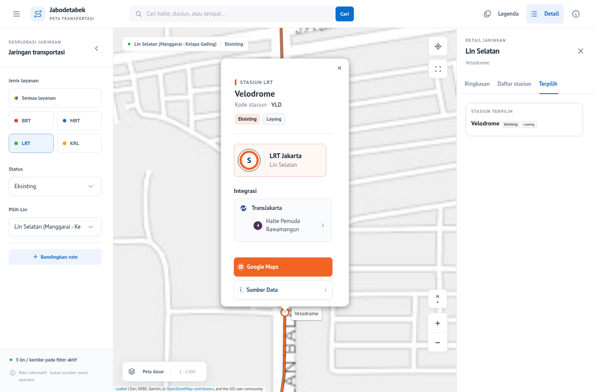
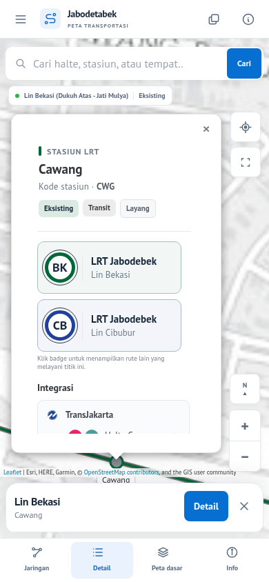

# Popup LRT, PT Sans dan UI mobile

Implementasi pada branch `feat/lrt-popup-pt-sans-mobile`, tanpa merge atau deployment.
Baseline aplikasi: `4e0985d69d51694840d72e28d48bb91800bb0abf` (UX Tabler terbaru).
Implementasi yang dipakai untuk screenshot sesudah: `10ca0c20c75b2b5538b847de0bcfcd6d445ff708`.

`main` saat pekerjaan dimulai adalah `10abd9e`, berisi layout Tabler awal.
Branch ini meneruskan penyempurnaan UX pada Draft PR #3 yang belum masuk main;
diff terhadap main turut mencakup dependensi tersebut. PR #1/A01 dan branch
prototipe sebelumnya tidak diubah. Jangan merge sebelum dependensi dan layout direview.

## Perubahan

| File | Perubahan dan batas tanggung jawab |
| --- | --- |
| `js/lrt-popup.js` | Adapter presentasi reusable khusus LRT. Membungkus renderer popup lama, mempertahankan node tombol, atribut event, tautan sumber/Maps, integrasi dan navigasi. |
| `css/lrt-popup.css` | Header, badge, simbol lin, kartu operator, integrasi, tindakan dan navigasi. Satu area scroll dengan tinggi mengikuti ruang peta; tombol tindakan tersusun vertikal bila dua kolom terlalu sempit. |
| `css/font-pt-sans.css` | Token font utama PT Sans, regular 400/bold 700, fallback Arial/sans-serif. Berlaku juga pada popup non-LRT, tooltip, label aplikasi dan kontrol Leaflet. |
| `assets/fonts/*`, `THIRD_PARTY_NOTICES.md` | Dua WOFF2 lokal, lisensi OFL dan asal/checksum. Tidak ada library UI tambahan. |
| `index.html` | Memuat adapter/CSS, preload regular dengan URL yang sama, menghapus request Google Fonts dan menyesuaikan CSP untuk font lokal. Hook DOM asli tetap tersedia. |
| `css/layout-tabler.css` | Breakpoint mobile ≤767, tablet 768–1023, desktop ≥1024; safe area, input 16 px mobile, sheet tiga posisi, landscape pendek dan keyboard. |
| `js/layout-tabler.js` | Koordinasi sheet/popup, visualViewport, ukuran popup berdasar kontrol/atribusi aktual, penyimpanan scroll LRT saat tour, pembatasan invalidateSize pada perubahan dimensi peta. |
| `js/layout-tabler-ux.js` | Menyamakan breakpoint dan membatasi kartu tour agar muat pada layar kecil. |
| `tools/test-*.mjs`, `package.json` | Regresi font/LRT/mobile serta penantian transisi pada dua assertion ukuran panel lama. |
| `tools/capture-lrt-mobile.mjs`, `docs/lrt-mobile/*` | Pengambilan gambar HTTP lokal dengan tile penyedia aktual, manifest, log tes dan audit pembanding. |

Tidak ada perubahan pada `js/map.js`, GeoJSON, identitas, urutan halte, warna
sumber, status maupun keputusan jaringan. Empat GeoJSON dan empat file engine/
legacy dalam manifest integritas tetap identik byte demi byte. Delapan file
tersebut dan 87 hook DOM lama diperiksa oleh regresi integritas.

## Metadata dan navigasi LRT

Operator dibaca dari `OPERATOR` feature/rute, bukan diasumsikan dari `MODE=LRT`.
Nama, kode stasiun, status, struktur, nama lin dan warna memakai metadata/helper
yang sudah ada. Simbol lin memakai kode badge renderer asli. Contoh dari data:

| Feature uji | Operator/lin aktual | Hasil |
| --- | --- | --- |
| Velodrome | LRT Jakarta — Lin Selatan, `#F26324` | Kode VLD, status/struktur dan integrasi Pemuda Rawamangun berasal dari sumber. |
| Halim | LRT Jabodebek — Lin Bekasi, `#006838` | Stasiun satu lin tetap memakai operator Jabodebek. |
| Cawang | LRT Jabodebek — Lin Bekasi dan Lin Cibubur (`#21409A`) | Pilihan lin mempertahankan stasiun; berikutnya Halim pada Bekasi, Taman Mini pada Cibubur. |

Tidak ada nama stasiun/lin/integrasi yang ditambahkan ke kode runtime.
ID/nama contoh di atas hanya merupakan fixture pengujian dan dokumentasi.
Navigasi memanggil mekanisme `getAdjacentStops` asli melalui handler lama.
Data LRT saat ini tidak mengaktifkan kontrol arah A/B; implementasi mengikuti
konteks lin/sequence yang tersedia dan tidak menciptakan arah baru.

## Perilaku mobile

Peta tetap menjadi area utama. Moda/lin/status tersedia melalui tombol Jaringan;
Search selalu tersedia; dock menyediakan Detail, Peta dasar dan Info/legenda.
Sidebar dan panel detail desktop dapat ditutup/dibuka. Tablet memakai overlay
bergantian agar panel tidak dipaksa sempit.

Detail memiliki posisi Ringkas, Sedang dan Penuh melalui tombol, dengan scroll
konten. Saat popup dibuka, detail menjadi strip 72 px. Membuka Detail menyimpan
popup dengan menyembunyikannya sementara; menutup panel mengembalikan popup yang
sama. Seleksi, tab dan URL dipertahankan. Pada landscape sangat pendek, strip
sementara disembunyikan agar popup tetap dapat digunakan; akses Detail tetap di dock.

Popup menyesuaikan ruang aktual antara Search, kontrol peta, sheet dan atribusi.
Satu area scroll LRT memuat konten sampai sumber/navigasi. Tombol close tetap
terjangkau. Safe area dan visualViewport dipakai; keyboard yang memperkecil
viewport memprioritaskan Search dan menyimpan panel/popup sementara.

Tidak ada penggantian dataset/backend, perubahan pemuatan GeoJSON paralel,
atau pembuatan ulang layer akibat pan/zoom. Overlay yang tidak mengubah ukuran
peta tidak memanggil `invalidateSize`. Animasi sheet 140 ms mengikuti preferensi
reduced motion. Tidak dipasang gesture drag sheet agar tidak mengganggu peta/scroll.

## Pengujian dan pembanding

Chromium otomatis digunakan, dengan aplikasi, Leaflet, font dan GeoJSON nyata.
Tes interaksi mengisolasi tile/geocoder eksternal agar deterministik; screenshot
memakai tile penyedia aktual melalui cache sementara. Leaflet CDN disuplai dari
paket npm versi identik dengan SRI. Screenshot baseline mengisolasi stylesheet
Google Fonts opsional dan memakai fallback sistem; screenshot sesudah memuat
WOFF2 PT Sans lokal yang sesungguhnya.

| Pemeriksaan | Baseline | Sesudah |
| --- | --- | --- |
| Build `npm run build:ui` | Build tersedia pada baseline | Lulus, output vendor/legacy tidak berubah |
| Regresi layout/UX lama | 19/19 lulus pada aplikasi baseline | Seluruh 19 dijalankan kembali |
| Suite gabungan `npm run test:layout` | 19 tes lama | 45/45 lulus: 19 lama + 11 mobile + 2 font + 13 LRT |
| `node tools/audit-navigation.mjs` | Lulus dengan catatan lama | Lulus, output identik |
| `node tools/audit.mjs` | Gagal | Gagal, output identik |
| `python3 tools/audit-k01-k10-rail.py` | Gagal | Gagal, output identik |
| Integritas delapan file terlindungi | Hash referensi | Semua cocok |

Log lengkap: [baseline](lrt-mobile/verification/baseline-layout-tests.tap),
[suite akhir](lrt-mobile/verification/layout-tests.tap),
[build](lrt-mobile/verification/build.log),
[audit pembanding](lrt-mobile/verification/audits.json).

Viewport wajib: **320×568, 360×800, 390×844, 768×1024, 1366×900, 1600×1000**.
Tambahan: 568×320 dan 844×390, batas 767/768/1024, serta simulasi keyboard 390×480.
Tes mencakup pembukaan awal, Koridor 1, kedua operator LRT, satu/multi-lin,
daftar stasiun, navigasi, integrasi, Search, status, buka/tutup panel, peta saat
panel terbuka, tour, state/URL, label panjang, font dan overflow.

Run awal suite gabungan menghasilkan 43/45. Dua kegagalan berasal dari langkah
tes: membaca ukuran sebelum transisi sheet selesai, serta mencoba mengubah
filter status ketika sheet jaringan sudah ditutup oleh pemilihan lin.
Tes sekarang menunggu kondisi ukuran dan membuka sheet sebelum memakai filter.
Pemeriksaan status juga mengikuti perilaku asli yang mengembalikan pilihan
ke Semua Lin: memeriksa ringkasan/layer, kemudian mencari stasiun.
Log awal disimpan di
[layout-tests-initial.tap](lrt-mobile/verification/layout-tests-initial.tap).
Temuan scroll bertingkat dan label tombol terpotong yang ditemukan saat
pengembangan diperbaiki dan ditambahkan pemeriksaan akses/ukuran label.

Audit data tetap melaporkan benturan STOP_ID/GEOM_ID, metadata K9/GlobalID dan
beberapa pointer integrasi rail lama. Tidak diperbaiki dalam pekerjaan UI ini.
Catatan navigasi BRT_14 dan sequence BRT_01 juga identik dengan baseline.

## Screenshot sebelum/sesudah

Semua gambar di bawah berasal dari browser lokal. Direktori lengkap:
[before](lrt-mobile/screenshots/before), [after](lrt-mobile/screenshots/after).
Manifest menyimpan viewport, commit aplikasi, state, jumlah tile dan checksum PNG.

| Skenario | Sebelum | Sesudah |
| --- | --- | --- |
| LRT Jakarta desktop | [Velodrome](lrt-mobile/screenshots/before/lrt-jakarta-1366.png) | [Velodrome](lrt-mobile/screenshots/after/lrt-jakarta-1366.png) |
| LRT Jakarta mobile | [Velodrome](lrt-mobile/screenshots/before/lrt-jakarta-390.png) | [Velodrome](lrt-mobile/screenshots/after/lrt-jakarta-390.png) |
| Jabodebek multi-lin desktop | [Cawang](lrt-mobile/screenshots/before/lrt-jabodebek-multiline-1366.png) | [Cawang](lrt-mobile/screenshots/after/lrt-jabodebek-multiline-1366.png) |
| Jabodebek multi-lin mobile | [Cawang](lrt-mobile/screenshots/before/lrt-jabodebek-multiline-390.png) | [Cawang](lrt-mobile/screenshots/after/lrt-jabodebek-multiline-390.png) |




Tambahan: [320 px](lrt-mobile/screenshots/after/lrt-jakarta-320.png),
[360 px](lrt-mobile/screenshots/after/koridor-1-360.png),
[tablet](lrt-mobile/screenshots/after/lrt-jabodebek-multiline-768.png),
[1600 px](lrt-mobile/screenshots/after/lrt-jabodebek-multiline-1600.png),
[filter mobile](lrt-mobile/screenshots/after/network-sheet-390.png),
[detail](lrt-mobile/screenshots/after/detail-sheet-390.png),
[tindakan popup](lrt-mobile/screenshots/after/lrt-jakarta-actions-390.png),
[landscape](lrt-mobile/screenshots/after/lrt-landscape-568.png).

## Menjalankan lokal

```sh
npm ci
npx playwright install chromium
npm run build:ui
npm run dev
npm run test:layout
npm run capture:lrt
```

Jika Chromium sistem digunakan, set `PLAYWRIGHT_CHROMIUM_EXECUTABLE_PATH`.
Untuk screenshot sebelum, arahkan `LAYOUT_APP_ROOT` ke checkout baseline dan
set `CAPTURE_STAGE=before`. Tile screenshot membutuhkan akses jaringan.

## Keterbatasan dan risiko

- Perangkat fisik, Safari iOS dan keyboard virtual asli belum tersedia. Perilaku
  notch, browser chrome, pinch dan keyboard diverifikasi lewat dukungan API/CSS
  dan resize otomatis Chromium; tetap perlu uji perangkat sebelum merge.
- Uji pan/zoom memeriksa identitas layer, state dan error, bukan benchmark FPS
  atau klaim performa pada ponsel kelas rendah.
- Adapter bergantung pada hook renderer popup lama. Tes menjaga atribut event,
  navigasi dan integrasi; perubahan renderer kelak perlu menjalankan suite ini.
- Font Latin lokal menggunakan fallback untuk glyph yang tidak tercakup;
  font di dalam tile basemap tidak disentuh.
- A01/A02 dan inkonsistensi data yang sudah diketahui tetap pada pekerjaan
  terpisah. Tidak ada migrasi database, merge main atau deployment.
- Fitur dalam lingkup ini sudah dihubungkan; gesture swipe sheet tidak
  ditambahkan karena kontrol posisi berupa tombol lebih stabil untuk tahap ini.
